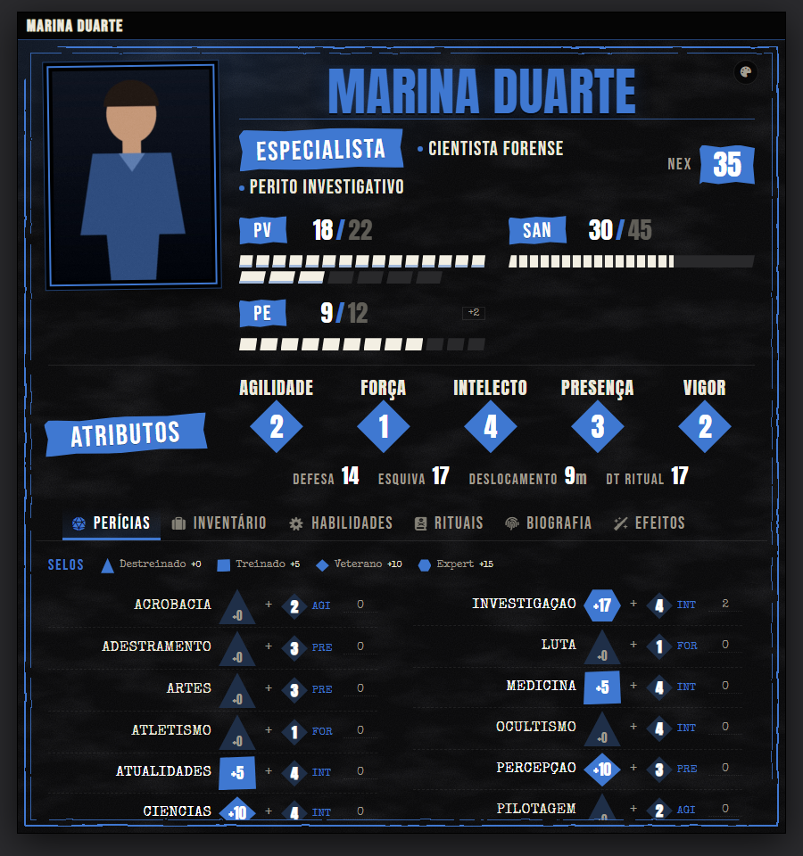
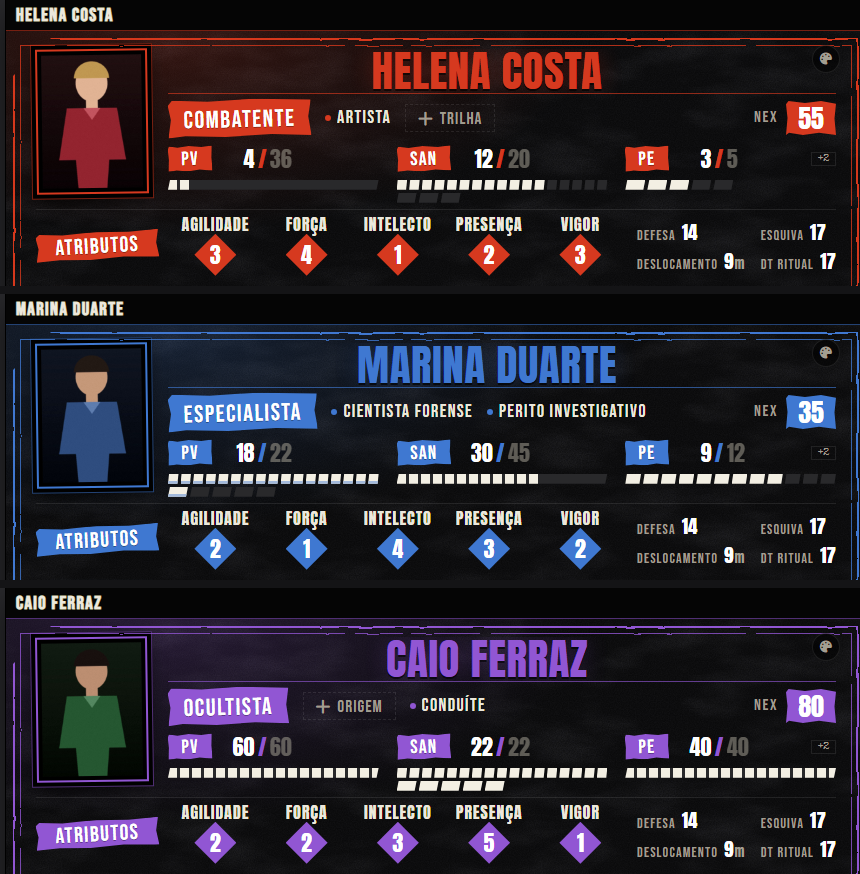
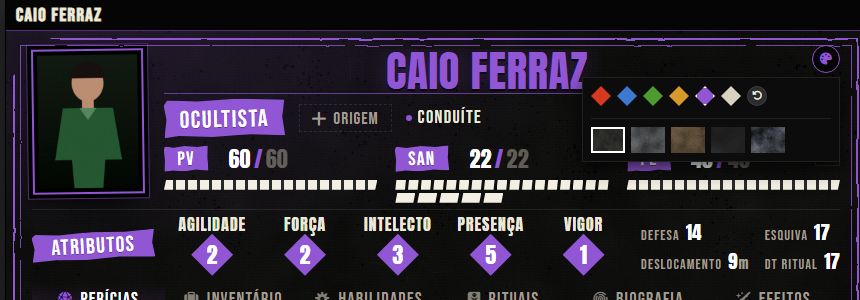

# Ordem Paranormal — Ficha Dossiê (estilo Playtest)

Uma ficha de agente alternativa para o sistema **[Ordem Paranormal](https://github.com/SouOWendel/ordemparanormal_fvtt)** no Foundry VTT, com a cara das fichas do playtest de Ordem Paranormal 2: fundo escuro e texturizado, moldura "impressa", etiquetas de fita rasgada, atributos em losangos, selos de treinamento e barras de vida em blocos.



> As imagens são ilustrativas (retratos genéricos, personagens inventados).

**Não muda nenhum dado.** A ficha usa exatamente os mesmos campos do sistema (atributos, PV/PE/SAN, NEX, perícias, itens). Dá para ativar, desativar ou trocar ator por ator sem perder nada, e rolagens, arrastar itens, efeitos e condições continuam funcionando como sempre, porque a ficha do módulo é uma extensão da original.

---

## Instalação

Precisa de **Foundry VTT 13 ou mais novo** e do sistema **Ordem Paranormal** (versão 8.0.0 ou superior) instalado.

### Pelo link (recomendado)

1. Abra o Foundry, vá na tela inicial (onde ficam *Game Worlds*, *Game Systems* e *Add-on Modules*).
2. Clique em **Add-on Modules** → **Install Module**.
3. Cole este link no campo **Manifest URL** e clique em **Install**:

   ```
   https://github.com/vinidevai/fichaordemestiloii/releases/latest/download/module.json
   ```

4. Abra o seu mundo, vá em **Game Settings → Manage Modules**, marque **Ordem Paranormal — Ficha Dossiê (estilo Playtest)** e salve.
5. Pronto: os agentes passam a abrir com a ficha nova.

> Se o módulo não aparecer na lista, confira se o mundo usa o sistema Ordem Paranormal. O módulo só aparece e só funciona nele.

### Manualmente

Baixe o `module.zip` da [última release](https://github.com/vinidevai/fichaordemestiloii/releases/latest), descompacte em `Data/modules/op-ficha-playtest/` (a pasta precisa ter esse nome) e reinicie o Foundry.

### Trocar ou voltar à ficha original

Na barra de título da ficha, abra o menu (os três pontinhos) → **Configurar Ficha** e escolha entre *Dossiê* e a ficha original do sistema. A escolha vale para aquele ator. Desativar o módulo devolve todos os agentes à ficha original.

---

## Como funciona

### Retrato em formato retrato, com a imagem inteira a um clique

O personagem não fica no meio da ficha: o retrato é uma moldura vertical que mostra o **topo** da imagem (ótimo para rostos), mesmo que a arte seja de corpo inteiro ou em qualquer pose. **Clique no retrato** para abrir a imagem completa em uma janela. Passe o mouse para ver o lápis de trocar a imagem.

### Cor de destaque por personagem

O ícone de paleta no canto superior direito muda a cor da ficha toda: vermelho, azul, verde, âmbar, roxo ou osso. Sem escolha, a cor vem da classe:

| Classe | Cor padrão |
|---|---|
| Combatente | vermelho |
| Especialista | azul |
| Ocultista | roxo |
| Sobrevivente | verde |

A cor é por personagem e fica salva no ator. Só quem é dono do personagem consegue trocar.





### PV, SAN e PE em blocos

Cada ponto é um bloquinho clicável. **Clique no bloco N** para deixar o recurso em N; clicar no último bloco cheio esvazia ele (assim dá para chegar a 0). Os números ao lado continuam editáveis. Acima de 30 pontos a barra vira uma tira contínua para não ficar gigante. Com a regra de jogar sem sanidade, aparecem PV e PD.

### Atributos, defesa e deslocamento

Os cinco atributos ficam em losangos. **Clique no nome** do atributo para rolar o teste. Logo abaixo ficam Defesa, Esquiva, Deslocamento e a DT dos rituais, calculados pelo sistema.

### Perícias: nome · selo · dados

As perícias ficam em ordem alfabética, em duas colunas. Cada linha tem:

```
NOME DA PERÍCIA   [selo +10]  +  [◆ 3] AGI   [bônus]
```

- **Nome**: clique para rolar o teste. Botão direito abre a regra da perícia no livro (função do sistema).
- **Selo**: o **formato** mostra o treinamento e o **número** é o bônus total da perícia. Clique nele para subir o treinamento.

  | Formato | Treinamento | Bônus |
  |---|---|---|
  | triângulo | destreinado | +0 |
  | quadrado | treinado | +5 |
  | losango | veterano | +10 |
  | hexágono | expert | +15 |

- **Dados do atributo**: o número no losango pequeno é o atributo-base (quantidade de dados), com a sigla ao lado.
- **Campo da direita**: bônus extra da perícia (itens, poderes, o que o mestre mandar).
- A **perícia livre** fica no fim da lista, com nome editável.

### Demais abas

Inventário, Habilidades, Rituais, Biografia e Efeitos usam o conteúdo do sistema, em tema escuro. Tudo o que você já tem nelas continua igual.

### Janela

A janela é redimensionável. Em larguras menores que ~700 px o cabeçalho se reorganiza sozinho (retrato menor, atributos em linha).

---

## Perguntas rápidas

**Isso é a ficha da 2ª edição?**
Não. O sistema do Foundry é de Ordem Paranormal 1.x (5 atributos, PV/PE/SAN, NEX). Aqui só o **visual** foi inspirado no playtest da 2ª edição. As regras e os campos são os do sistema que você já usa.

**Vai estragar meus personagens?**
Não. O módulo só desenha os dados de outro jeito. A única coisa que ele grava é a cor escolhida (uma flag no ator).

**Funciona com os meus módulos de rolagem/automação?**
As rolagens são as do sistema, então tudo que se conecta a elas continua funcionando. Se algum módulo mexer no HTML da ficha original, ele pode não achar os mesmos elementos na ficha nova.

**Os jogadores precisam instalar algo?**
Não. Instalou no servidor, todo mundo vê.

**Achei um bug ou quero uma cor/ajuste.**
Abra uma [issue](https://github.com/vinidevai/fichaordemestiloii/issues). Se for visual, um print ajuda muito.

---

## A ficha não apareceu?

1. Confira se o módulo está **ativo no mundo** (Game Settings → Manage Modules) e se o mundo usa o sistema Ordem Paranormal.
2. Recarregue a página (F5). Depois de instalar ou atualizar um módulo, o Foundry só carrega o código novo ao recarregar.
3. Abra a ficha de um agente → menu (três pontinhos) → **Configurar Ficha**. A opção **Ordem Paranormal — Dossiê (Playtest)** deve estar na lista.
4. Se o registro falhar, o GM vê um aviso vermelho na tela. Aperte **F12**, aba *Console*, e procure linhas que começam com `op-ficha-playtest |`. Abra uma [issue](https://github.com/vinidevai/fichaordemestiloii/issues) com essas linhas e a versão do Foundry (a do console: `game.version`).

## Para quem quiser mexer

```
module.json              manifesto
scripts/main.mjs         registra a ficha (herda a OrdemActorSheet do sistema)
scripts/dossie-sheet.mjs classe da ficha: contexto, ações (retrato, blocos, selos, cor)
templates/dossie.hbs     cabeçalho
templates/skills.hbs     aba de perícias
templates/tabs.hbs       navegação por abas
styles/dossie.css        tema inteiro, aninhado em .op-dossie
fonts/                   Anton, Bebas Neue, Special Elite
lang/                    pt-BR e en
```

- A ficha **herda** a ficha de agente do sistema, então só o que muda de aparência foi reescrito (cabeçalho, perícias, abas). O resto (itens, rituais, efeitos, arrastar e soltar) é do sistema.
- O CSS fica sob `.system-ordemparanormal .application.ordemparanormal.actor.op-dossie` para ter prioridade sobre o CSS do sistema sem `!important` em todo lugar.
- As abas reaproveitadas do sistema ficam escuras com `filter: invert(1) hue-rotate(180deg)`. É uma solução prática, não a mais elegante; se quiser refazer alguma aba com visual próprio, é só trocar o template da parte correspondente em `static PARTS`.
- **Lançar uma versão nova:** crie uma release com tag `vX.Y.Z`. O fluxo em `.github/workflows/release.yml` atualiza o `module.json`, gera o `module.zip` e anexa os dois à release, e o link de instalação passa a entregar a versão nova.

## Status

Versão 1.0.0, primeira versão pública. Foi escrita para o Foundry 13+ e o sistema Ordem Paranormal 8.0.2. Se algo se comportar diferente na sua mesa, conte nas issues.

## Créditos e licenças

- Ordem Paranormal é criação de **Cellbit**. Este módulo é **não oficial** e não tem ligação com os criadores ou com a editora. As fichas do playtest serviram só de inspiração visual; nenhuma arte delas está neste repositório.
- Sistema para Foundry: [ordemparanormal_fvtt](https://github.com/SouOWendel/ordemparanormal_fvtt), de SouOWendel e colaboradores. Este módulo depende dele.
- Código do módulo: [MIT](LICENSE).
- Fontes: [Anton](https://fonts.google.com/specimen/Anton) e [Bebas Neue](https://fonts.google.com/specimen/Bebas+Neue) (SIL OFL 1.1) e [Special Elite](https://fonts.google.com/specimen/Special+Elite) (Apache 2.0). Licenças completas em `fonts/`.
